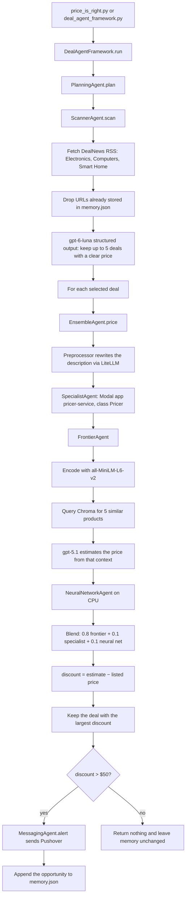
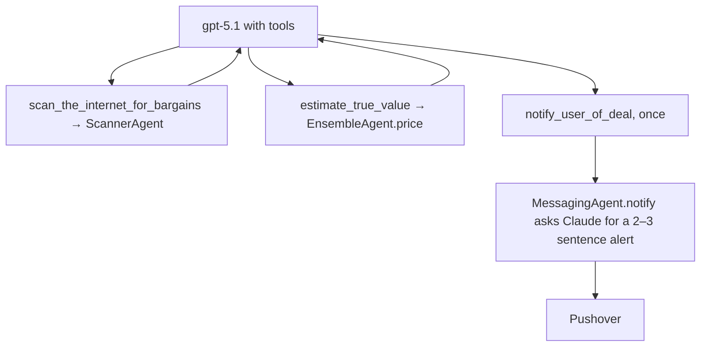

# The Price is Right

A local agent framework that reads DealNews RSS feeds, estimates what each product should cost, and sends a Pushover alert when the discount is larger than $50.

`price_is_right.py` is the Gradio UI. `deal_agent_framework.py` runs the same planning cycle once from the command line. Both call `PlanningAgent`, which coordinates the other agents in a fixed order.

## Agent call flow

On startup the framework opens the Chroma collection `products` in `products_vectorstore` and loads past opportunities from `memory.json`. Agents are created on the first run, then reused.



The three pricers run one after another on the rewritten description. The ensemble waits for all three numbers, then returns the weighted sum. The planner prices at most five deals, sorts them by discount, and alerts only for the winner when that discount is greater than $50.

The Gradio app starts a run as soon as the page loads, then repeats it every 5 minutes. Clicking a row in the deals table calls `MessagingAgent.alert` again for that opportunity. The 3D plot is separate from this loop: at startup it reads embeddings from the same Chroma collection and draws them with t-SNE.

## What each agent does

| Agent | Called by | What it does |
|---|---|---|
| Planning Agent | `DealAgentFramework` | Runs scan, then price, then alert. Threshold is $50. |
| Scanner Agent | Planning Agent | Scrapes DealNews and asks `gpt-6-luna` for the five clearest deals. |
| Ensemble Agent | Planning Agent, once per deal | Rewrites the description and blends the three price estimates. |
| Preprocessor | Ensemble Agent | Rewrites the listing into title, category, brand, description, and details. Default model is `openai/gpt-6-luna`. |
| Specialist Agent | Ensemble Agent | Calls the deployed Modal class `Pricer` on the app `pricer-service`. Weight 0.1. |
| Frontier Agent | Ensemble Agent | Retrieves five similar products from Chroma, then asks `gpt-5.1` for a price. Weight 0.8. |
| Neural Network Agent | Ensemble Agent | Runs the local deep network in `deep_neural_network.pth` on CPU. Weight 0.1. |
| Messaging Agent | Planning Agent, and a table click in the UI | Pushes a short deal alert through Pushover. |

## Autonomous planner

`agents/autonomous_planning_agent.py` is a second planner. It is not what the UI or `deal_agent_framework.py` calls. A `gpt-5.1` tool loop decides the order itself:



`MessagingAgent.alert` is the fixed planner's path and does not call Claude. `MessagingAgent.notify` is only used by this autonomous planner.

## Setup

The Chroma collection has to already contain product documents and embeddings. Opening the app creates an empty `products` collection if the folder is missing, and the plot cannot run t-SNE on zero vectors. The frontier agent also needs those vectors to retrieve similar products.

The neural network loads `deep_neural_network.pth` onto CPU.

Put keys in `.env`:

```
OPENAI_API_KEY=
PUSHOVER_USER=
PUSHOVER_TOKEN=
```

`PRICER_PREPROCESSOR_MODEL` overrides the preprocessor model. The specialist agent expects a deployed Modal app named `pricer-service` with a class named `Pricer`.

Install the packages the scripts import: `modal`, `python-dotenv`, `torch`, `openai`, `litellm`, `chromadb`, `gradio`, `plotly`, `scikit-learn`, `sentence-transformers`, `feedparser`, `beautifulsoup4`, `pydantic`, and `requests`.

## Run

One planning cycle:

```bash
uv run deal_agent_framework.py
```

Gradio UI, in the browser, repeating every 5 minutes:

```bash
uv run price_is_right.py
```
